# English–Hindi Machine Translation: Technical Report

**Foundations of Generative AI (ICT4403), Assignment 3**

## 1. Problem and objective

The task is to translate English sentences into Hindi while preserving meaning, names, numbers, and sentence structure. This report compares four complete systems: a Transformer encoder–decoder trained from scratch, fine-tuned mT5-small, and two decoder-only instruction models used with three in-context examples. It measures corpus BLEU, corpus chrF, TER, generation time, parameter count, sentence-level chrF, tokenizer behaviour, and automatic output-risk flags.

## 2. Dataset and evaluation sample

The dataset is the [IIT Bombay English–Hindi Parallel Corpus](https://www.cfilt.iitb.ac.in/iitb_parallel/), also available from the [Hugging Face mirror](https://huggingface.co/datasets/cfilt/iitb-english-hindi). The recorded licence is CC BY-NC 4.0. The corpus citation and exact cached dataset revision are in [model_provenance.json](../results/model_provenance.json).

Text preparation applies Unicode normalization, whitespace and control-character cleanup, script and length checks, and training-pair deduplication. The raw training split had 1,659,083 rows. Cleaning removed 51,232 rows; pair deduplication removed 258,395 more. A seeded 60,000-pair training file was retained, together with all 520 validation pairs and all 2,507 test pairs. The normalized source-overlap audit found zero cross-split matches. The saved test file contains one repeated normalized pair within the test split; that is distinct from cross-split leakage.

The **full test set has 2,507 examples**. A **sample of 200** was drawn once from that official test split with seed 42 and stored in [evaluation_sample.json](../results/evaluation_sample.json). The four systems use the same row IDs, order, sources, and references. The separate temperature study uses 20 of those rows.

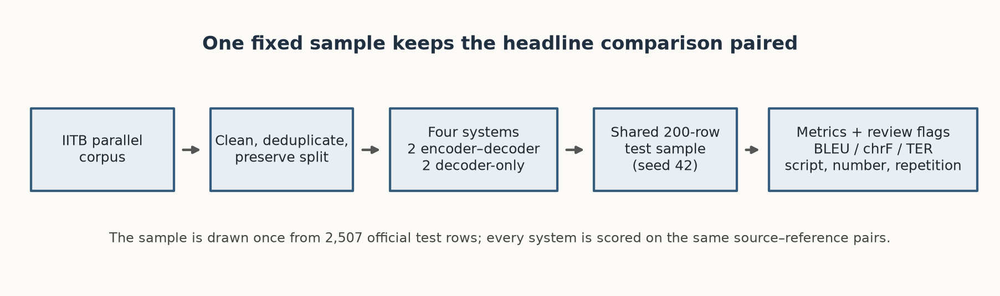

*Figure 1. Data preparation and paired evaluation path.*

Vector copy: [pipeline_flow.svg](../results/figures/pipeline_flow.svg).

The diagram shows that all four systems share one 200-row evaluation sample from the 2,507-row test split.

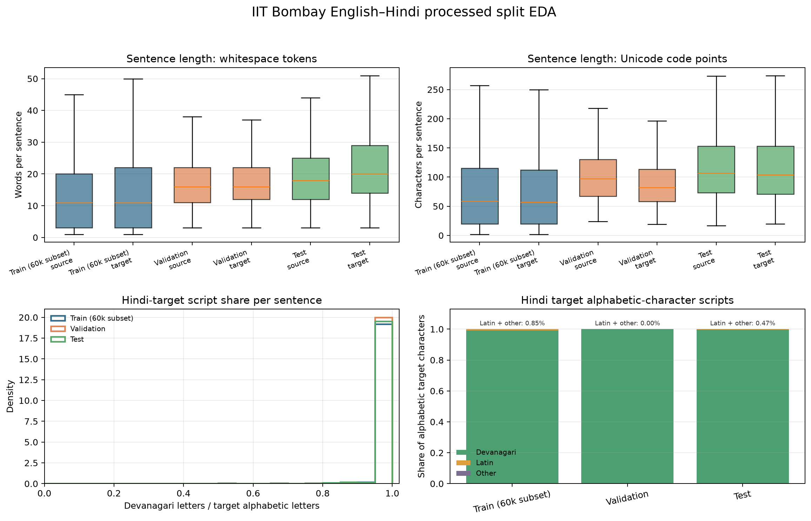

*Figure 2. Processed split length distributions and target-script composition.*

The 60,000-row training subset has median source and target lengths of 11 whitespace words each; the full test split has medians of 18 source words and 20 target words. Devanagari makes up 99.58% of the test targets’ alphabetic characters on average, so the small non-Devanagari remainder is visible but uncommon.

## 3. Systems and adaptation

| System | Architecture | Parameters | Pretraining and task adaptation | Tokenizer |
|---|---|---:|---|---|
| Basic Transformer (from scratch) | 6-layer encoder + 6-layer decoder | 15.2M | No pretrained weights; trained on 12,000 pairs | SentencePiece, 8,000 pieces |
| mT5-small (fine-tuned) | 8-layer encoder + 8-layer decoder | 300.2M | Multilingual mC4-pretrained weights; fine-tuned on 60,000 pairs | SentencePiece, 250,112 pieces |
| TinyLlama 1.1B (3-shot prompt) | Decoder-only causal LM | 1,100.0M | LLaMA-family pretrained checkpoint; three fixed examples, no local weight updates | Model tokenizer; audit reports 5.55 Hindi tokens per whitespace word |
| Gemma 3 1B (3-shot prompt) | Decoder-only causal LM | 999.9M | Instruction-tuned pretrained checkpoint; three fixed examples, no local weight updates | Model tokenizer; audit reports 1.364 Hindi tokens per whitespace word |

The scratch Transformer uses 256-dimensional embeddings, eight attention heads, a 1,024-unit feed-forward layer, and a vocabulary of 8,000 SentencePiece pieces. The mT5 model uses 512-dimensional hidden states, six attention heads, a 1,024-unit feed-forward layer, and a vocabulary of 250,112 pieces. The encoder–decoder systems receive an English source and produce a separate Hindi target sequence. The decoder-only systems continue a causal chat prompt containing the task instruction, demonstrations, and source.

mT5 was pretrained on mC4, a multilingual corpus described in its paper as covering 101 languages. The model revision and licence record are in [model_provenance.json](../results/model_provenance.json). TinyLlama is a LLaMA-family model, not an official Meta LLaMA checkpoint. Its paper gives different total-token figures in the abstract and body, so this report does not use an exact TinyLlama token-count comparison. Gemma was loaded from an Unsloth mirror of the Gemma 3 1B instruction checkpoint; Gemma Terms of Use apply. The official [Gemma 3 model card](https://ai.google.dev/gemma/docs/core/model_card_3) describes the 1B model as trained on 2 trillion tokens and data spanning more than 140 languages. Those pretraining descriptions are not directly comparable measures of task-relevant Hindi exposure.

### Decoder-only prompt format

Both decoder-only systems use the same system message and user text. The model-specific chat template wraps these messages; the three saved user/assistant demonstrations precede the final test request.

    System:
    You are a careful professional translator. Translate English sentences into natural Hindi. Preserve meaning, names and numbers. Never add explanations, transliteration, notes or quotes.

    Repeat for each of the three saved examples:
    User:
    Translate the following English sentence into Hindi. Reply with the Hindi translation only.

    English: {demonstration source}
    Hindi:
    Assistant: {saved Hindi target}

    Final test request:
    User:
    Translate the following English sentence into Hindi. Reply with the Hindi translation only.

    English: {test source}
    Hindi:
    Assistant:

The three example pairs are selected from training rows by the recorded rule “first n training rows with 7–18 source words”; the exact pairs are stored in [prompt_shots.json](../results/prompt_shots.json). Headline decoder-only results use greedy decoding. Neither decoder-only model receives gradient updates in this evaluation.

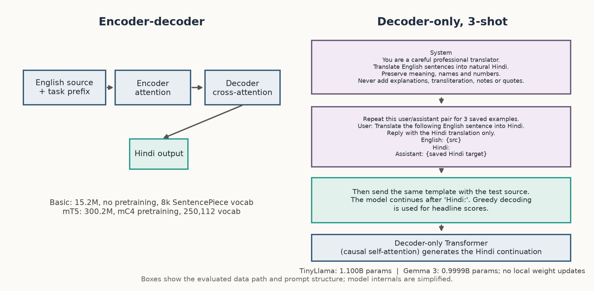

*Figure 3. Simplified model paths and the exact instruction/pair format used by the prompt systems.*

Vector copy: [architecture_comparison.svg](../results/figures/architecture_comparison.svg).

The scratch model has 15.2M parameters and an 8,000-piece vocabulary; mT5 has 300.2M parameters and a 250,112-piece vocabulary. TinyLlama and Gemma each have about one billion parameters, but their Hindi tokenizer fertility differs by roughly 4.1× (5.55 versus 1.364 tokens per reference word), a relevant input/output-length difference rather than a quality score.

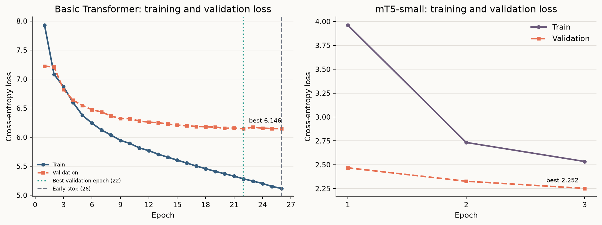

*Figure 4. Training and validation cross-entropy at the saved epoch checkpoints.*

The scratch model’s validation loss reaches 6.1463 at epoch 22 and is 6.1469 at its final saved epoch; its final training loss is 5.1182. mT5’s validation loss moves from 2.4672 to 2.3268 to 2.2517 across its three recorded checkpoints, while the run records 5,625 optimizer steps and 12,379.4 seconds of training.

## 4. Execution and dependencies

The recorded environment is Windows 11, Python 3.13, PyTorch 2.9.1, and CUDA 12.8. The dependency pins are in requirements.txt and include Transformers, Hugging Face Datasets, SentencePiece, SacreBLEU, pandas, NumPy, and Matplotlib. Install the CUDA-compatible PyTorch build before the remaining packages.

From the project root, create the environment and install dependencies:

    python -m venv .venv
    .venv\Scripts\python.exe -m pip install --upgrade pip
    .venv\Scripts\python.exe -m pip install -r requirements.txt

The end-to-end orchestrator is scripts/run_all.ps1. It expects processed splits, local model checkpoints, and cached model files; it runs the configured evaluation pipeline, including inference and scoring. The saved-artifact gate and figure generator can be run after those artifacts exist:

    .venv\Scripts\python.exe scripts\08_check_artifacts.py
    .venv\Scripts\python.exe scripts\16_report_figures.py

The gate checks existing outputs. The figure generator reads saved translations and result files; it does not train models or run inference.

For a fresh-clone, lightweight setup that reproduces the committed images, install the exact plotting and gate dependencies from [requirements-report-figures.txt](../requirements-report-figures.txt). It pins Matplotlib 3.11.2, matching the full [requirements.txt](../requirements.txt) environment and the version used to generate these figures.

## 5. Evaluation design

Headline scores are computed from the saved translations for the same 200 examples. SacreBLEU uses the 13a tokenizer; chrF uses character order 6 and word order 0; TER is a lower-is-better secondary metric. BLEU confidence intervals use 400 sentence-level bootstrap resamples with the recorded fixed seed. Inference time is generation-only wall time for the 200 rows and excludes model loading. Parameter counts use full model tensor shapes before 4-bit loading; therefore quantized memory use is not represented by the parameter column.

A second, paired BLEU bootstrap uses the same row alignment to estimate score differences between systems. Its “fraction at or below zero” is the share of bootstrap deltas that are non-positive; it is not a p-value. The extra sentence-level chrF intervals in Figure 5 (right panel) are percentile intervals from 400 resampled means of the 200 sentence chrF scores. They are separate from corpus chrF in the headline score table.

## 6. Results

| System | Parameters | Train/adapt time (s) | Inference time (s) | Sentences/s | BLEU (95% bootstrap CI) | Corpus chrF | TER |
|---|---:|---:|---:|---:|---:|---:|---:|
| Basic Transformer (from scratch) | 15.2M | 463.9 | 15.07 | 13.27 | 0.262 (0.190–0.326) | 9.624 | 145.377 |
| mT5-small (fine-tuned) | 300.2M | 12,379.4 | 128.95 | 1.55 | 7.581 (6.376–8.753) | 29.335 | 82.141 |
| TinyLlama 1.1B (3-shot prompt) | 1,100.0M | — | 389.144 | 0.51 | 0.358 (0.264–0.448) | 13.663 | 118.142 |
| Gemma 3 1B (3-shot prompt) | 999.9M | — | 250.85 | 0.80 | 10.952 (9.345–12.383) | 35.566 | 84.998 |

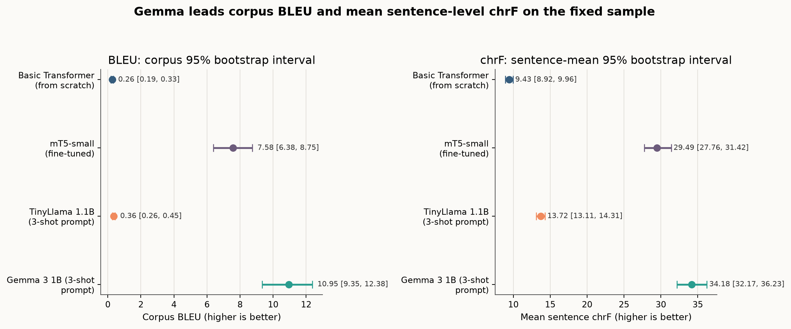

*Figure 5. Corpus BLEU bootstrap intervals and sentence-level chrF mean intervals.*

Gemma has the highest corpus BLEU at 10.952, and its BLEU interval does not overlap mT5’s interval. Its mean sentence-level chrF is 34.180 (95% bootstrap interval 32.169–36.235), compared with mT5’s 29.486 (27.759–31.419).

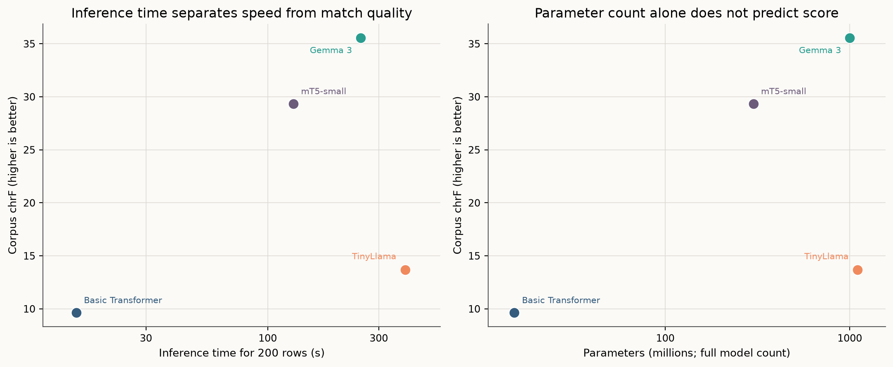

*Figure 6. Corpus chrF shown against measured generation time and parameter count.*

Gemma has the highest corpus chrF at 35.566 and takes 250.85 seconds; mT5 scores 29.335 chrF in 128.95 seconds. TinyLlama scores 13.663 chrF and is slowest at 389.144 seconds; the scratch Transformer scores 9.624 chrF in 15.07 seconds. Batch sizes and decoding differ, so the points describe this run rather than a controlled hardware-efficiency benchmark.

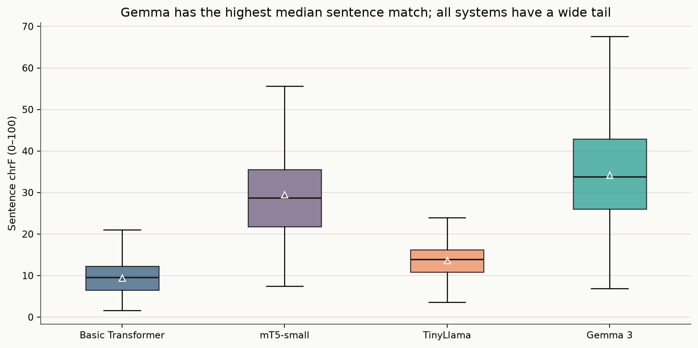

*Figure 7. Sentence-level chrF distribution on the 200 shared examples.*

The mean/median sentence chrF pairs are 9.432/9.558 for the scratch Transformer, 29.486/28.683 for mT5, 13.721/13.817 for TinyLlama, and 34.180/33.782 for Gemma. Every system has a distribution across the same rows; the central scores do not imply that every sentence was translated well.

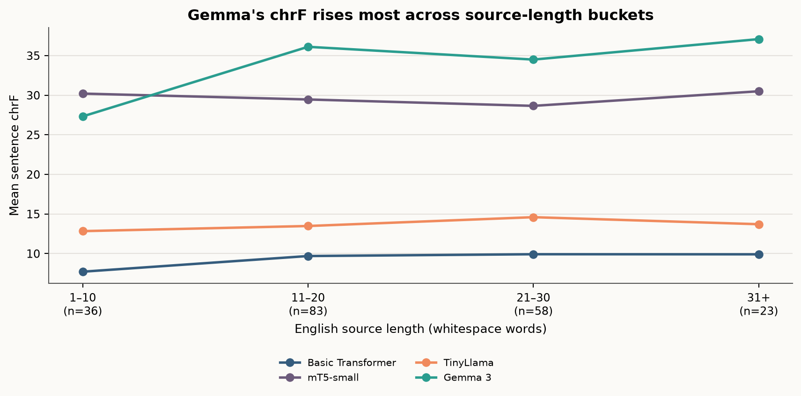

*Figure 8. Mean sentence chrF by source length, measured in whitespace-delimited English words.*

The bucket sizes are 36, 83, 58, and 23 sentences for 1–10, 11–20, 21–30, and 31+ words. Gemma’s bucket means are 27.329, 36.118, 34.505, and 37.089; the scratch Transformer’s are 7.719, 9.697, 9.924, and 9.914. Bucket differences are descriptive and the 31+ group has only 23 rows.

## 7. Model comparison and evaluation

### What the comparison can establish

The tokenizer audit covers the same 2,507 Hindi references for all four systems. Basic Transformer uses 1.586 pieces per whitespace word and mT5 uses 2.058; TinyLlama uses 5.55 and Gemma uses 1.364. Their mean Hindi token counts are 36.08, 46.83, 126.28, and 31.02 per reference, respectively. The two decoder-only systems use a 192-token output cap: 393 TinyLlama reference strings and zero Gemma references exceed it. Reference tokenization is a length diagnostic; it does not establish whether a generated output was truncated. The encoder–decoder figures were computed by tokenizing the local test TSV only; that TSV remains excluded from the publication set, while the basic SentencePiece model and pinned mT5 tokenizer revision are documented with the calculation script.

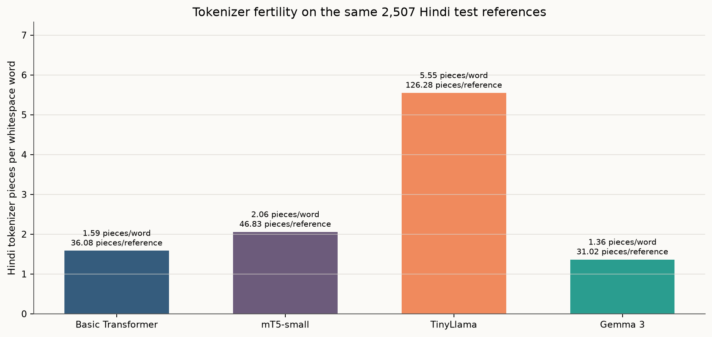

*Figure 9. Hindi tokenizer pieces per whitespace word and mean pieces per reference for the full test set.*

| Measure | Encoder–decoder | Decoder-only |
|---|---|---|
| Systems | Basic Transformer; mT5-small | TinyLlama 1.1B; Gemma 3 1B |
| Best measured BLEU / corpus chrF | mT5-small: 7.581 / 29.335 | Gemma 3: 10.952 / 35.566 |
| Parameters | 15.2M; 300.2M | 1,100.0M; 999.9M |
| Task-specific training/adaptation cost | Basic: 463.9 s on 12,000 pairs; mT5: 12,379.4 s fine-tuning on 60,000 pairs | No local weight updates; three fixed prompt examples per system |
| Inference time / throughput (200 rows) | Basic: 15.07 s / 13.27 sentences/s; mT5: 128.95 s / 1.55 sentences/s | TinyLlama: 389.144 s / 0.51 sentences/s; Gemma: 250.85 s / 0.80 sentences/s |
| Hindi tokenizer fertility (pieces per whitespace word) | Basic: 1.586; mT5: 2.058 | TinyLlama: 5.55; Gemma: 1.364 |
| Adaptation method | Basic: supervised training from scratch; mT5: supervised fine-tuning | Pretrained instruction checkpoints with three-shot prompting |

On this sample, the best decoder-only system, Gemma, scores higher on BLEU and corpus chrF than the best encoder–decoder system, mT5: 10.952 versus 7.581 BLEU and 35.566 versus 29.335 chrF. mT5 is smaller and faster in the measured run (128.95 seconds, 1.55 sentences/s) than Gemma (250.85 seconds, 0.80 sentences/s), but it required 12,379.4 seconds of fine-tuning while Gemma used prompting without local weight updates. The scratch encoder–decoder is fastest at 15.07 seconds (13.27 sentences/s), with much lower scores. These results do not isolate architecture's effect because (1) model size and pretraining, (2) task-specific data and adaptation, and (3) tokenization, decoding, batch size, and hardware conditions vary across systems.

### Paired BLEU bootstrap

The paired bootstrap resamples the same 200 row IDs and defines delta as score for system A minus score for system B.

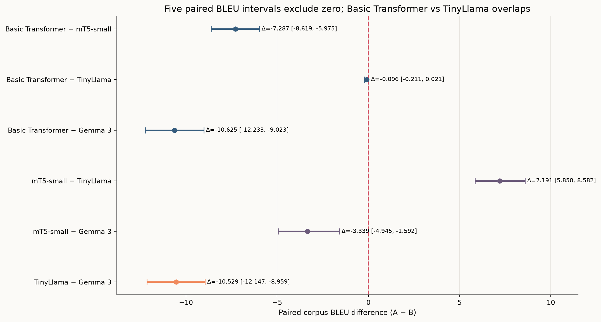

*Figure 10. Paired BLEU-difference intervals; the vertical zero line marks equal point scores.*

Figure 10 shows all six pairwise contrasts. Five intervals exclude zero; the Basic Transformer minus TinyLlama interval (−0.211 to 0.021) is the one that includes zero. The mT5 minus Gemma interval (−4.945 to −1.592) is entirely below zero; its paired resamples favour Gemma on this sample.

| A minus B | BLEU delta | 95% paired bootstrap interval | Fraction of deltas ≤ 0 |
|---|---:|---:|---:|
| Basic Transformer − mT5 | −7.287 | −8.619 to −5.975 | 1.00 |
| Basic Transformer − TinyLlama | −0.096 | −0.211 to 0.021 | 0.94 |
| Basic Transformer − Gemma | −10.625 | −12.233 to −9.023 | 1.00 |
| mT5 − TinyLlama | 7.191 | 5.850 to 8.582 | 0.00 |
| mT5 − Gemma | −3.339 | −4.945 to −1.592 | 1.00 |
| TinyLlama − Gemma | −10.529 | −12.147 to −8.959 | 1.00 |

The intervals quantify resampling variation over these 200 examples. They do not include run-to-run training variation or systematic uncertainty in the test sample.

## 8. Sampling-temperature analysis

The temperature study covers the first 20 rows of the fixed 200-row sample. The same three demonstrations are used at temperatures 0.2, 0.7, and 1.0, with top-p 0.9 and seed 42. It is a small descriptive analysis rather than a selection of the headline decoding setting.

| System | Temperature | BLEU | chrF | Distinct-2 |
|---|---:|---:|---:|---:|
| TinyLlama 1.1B | 0.2 | 0.408 | 13.861 | 0.6481 |
| TinyLlama 1.1B | 0.7 | 0.568 | 15.531 | 0.8998 |
| TinyLlama 1.1B | 1.0 | 0.559 | 15.436 | 0.9798 |
| Gemma 3 1B | 0.2 | 12.462 | 38.772 | 0.9490 |
| Gemma 3 1B | 0.7 | 10.259 | 35.902 | 0.9375 |
| Gemma 3 1B | 1.0 | 8.826 | 34.734 | 0.9330 |

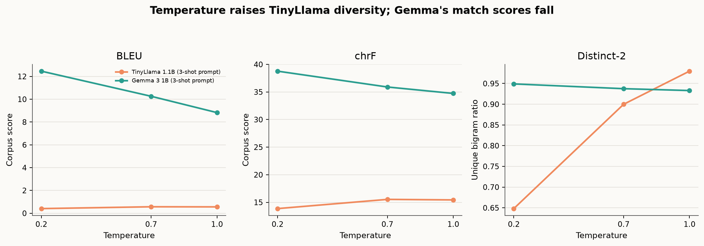

*Figure 11. Automatic scores and lexical diversity on the same 20 rows.*

Gemma’s BLEU decreases from 12.462 at temperature 0.2 to 8.826 at 1.0, while chrF falls from 38.772 to 34.734. TinyLlama’s Distinct-2 rises from 0.6481 to 0.9798 as temperature increases, but BLEU remains below 0.6. With only 20 examples, these shifts should not be generalized to other prompts or domains.

## 9. Responsible use and sampled errors

The automated screen covers empty output, missing Devanagari, added or dropped numbers, untranslated Latin text, repeated text, and unusual output-to-reference length ratios. It found no empty outputs in the 200-row sample. The model-specific rates below are proportions of outputs; for example, 47.0% is 94 of 200 rows.

| Flag | Basic Transformer | mT5-small | TinyLlama | Gemma 3 |
|---|---:|---:|---:|---:|
| Repetition loop | 47.0% | 6.5% | 22.5% | 0.5% |
| Dropped number | 18.0% | 6.5% | 14.0% | 2.0% |
| Added number | 9.0% | 4.0% | 0.0% | 1.5% |
| No Devanagari | 0.0% | 0.0% | 0.0% | 5.5% |
| Untranslated Latin span | 0.0% | 1.0% | 0.5% | 14.0% |
| Output/reference length ratio > 2 | 19.5% | 0.0% | 12.5% | 1.0% |
| Output/reference length ratio < 0.5 | 18.5% | 2.5% | 1.5% | 4.0% |

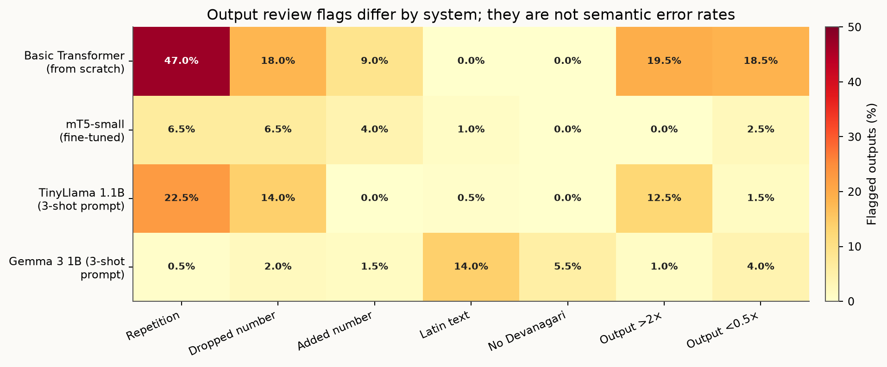

*Figure 12. Heuristic warning rates for outputs from the same 200 examples.*

The largest contrast is repetition: 47.0% for the scratch Transformer and 0.5% for Gemma. Gemma instead has the highest untranslated-Latin rate at 14.0% and a 5.5% no-Devanagari rate. These are review triggers, not human judgements; a flag may be acceptable in context, and an unflagged output may still change meaning.

The saved translations for rows 1126, 356, and 899 are shown verbatim below. The table includes each English source, its saved Hindi reference, and all four system outputs. The error notes identify observable differences from the source or reference; they do not assign a full adequacy score.

| Row | English source | Hindi reference | Basic Transformer | mT5-small | TinyLlama | Gemma 3 |
|---:|---|---|---|---|---|---|
| 1126 | Australian airline passengers will need to continue turning off their tablets and smart phones during take-off and landing despite moves in the US to loosen regulations covering the devices. | US में उपकरण सम्बन्धित विनियमनों में नरमी बरते जाने वाले कदम के बावजदू, ऑस्ट्रेलियाई वायुयान यात्रियों को उड़ान भरते समय तथा विमान उतरते समय अपने टेब्लेट और स्मार्ट फोन बंद करना जारी रखना होगा। | इस प्रकार के लिए, एक समय के लिए, एक ऊण् रहे हैं कि इस तरह की ओर की ओर से एक समय से अधिक से एक तरह की ओर से अधिक एक तरह से एक तरह की ओर से अधिक-साट के रूप से एक तरह से एक तरह से अधिक से अधिक से अधिक-साट के पास से एक तरह से अधिक-साट के रूप में एक तरह की ओर से अधिक-साट-साट के पास से एक तरह से एक तरह है। | अमेरिकी विदेशी यात्रियों को अपनी टेलीफोन और स्मार्ट फोन बंद करने के बाद अपने टैब और स्मार्ट फोन बंद करने की जरूरत होगी। | अफ्रियान्डे एक्‍ट्रेंड फाइनल फाइनल्‍ड फोन और स्मार फोन के लिए इस देश के साथ इस्‍तेमाल के बढ़ते इस्‍तेमाल के लिए दूरी के लिए अंग्‍वर्‍ड फाइनल फाइनल्‍ड �� | ऑस्ट्रेलियाई एयरलाइंस के यात्री अपने टेक-ऑफ और लैंडिंग के दौरान अपने टेबलेट और स्मार्टफोन को बंद रखने के लिए जारी रहेंगे, भले ही संयुक्त राज्य अमेरिका में उन उपकरणों को कवर करने वाले नियमों को ढीला कर दिया गया हो। |
| 356 | Sunder s/o Sohanveer, a resident of Madhi Village, had recently retired from the post of junior engineer from the Electrical Department. | मढ़ी गांव निवासी सुंदर पुत्र सोहनवीर अभी हाल ही में विद्युत विभाग से अवर अभियंता के पद से सेवानिवृत्त हुए हैं। | इस प्रकार के लिए, टोएटोटोटोटोटोटोटोटोटोट, मॉटोटोटोटोटोट, मॉन, मलल, मॉन, मॉट, मॉटॉटॉट, मॉटन, मरी, मॉन, . | मददी गांव के एक वासी, हाल ही में बाद में इलेक्ट्रॉनिक विभाग से वरिष्ठ इंजीनियरी के पद पर नियुक्त हो गया था। | सुनुर स/ओ सोहानेवर, मधि विश्‍वास में एक उपकरक ज्‍यादा उपयोगकर्ता है। | सुंदर/सुंदर, सोहनवीर के पुत्र/दुaughter, मदहो गांव के निवासी, हाल ही में इलेक्ट्रिकल डिपार्टमेंट के जूनियर इंजीनियर से सेवानिवृत्त हो गए। |
| 899 | Perry said she had dinner with the veteran rocker and that "he hit on me when I was 18." | पेरी ने कहा कि उन्होंने वरिष्ठ रॉकर के साथ डिनर किया था, तथा ‘जब मैं 18 वर्ष की थी, तो उन्होंने मुझ पर प्रहार किया।" | और हम लोग अपने पास-साहों के साथ-साहों के साथ-छे हैं, | उन्होंने कहा कि वह नौकरशाह के साथ भोजन किया था और कहा कि "मैं 18 थी जब मैं 18 था।" | प्रेर्‍य ने एक साल से उसकी सर्‍विस की सुरक्षा में उन्‍हें देखा है। उन्‍हें उसकी उपाकत की सुरक्षा में उन्‍हें उसकी सुरक्षा की सुरक्षा की सुरक्षा की सुरक्षा की सुरक्षा की सुरक्षा | पीटर ने कहा कि वह एक के बूढ़े रॉकर्स के साथ खाना खाती थी और कि वह जब वह 18 साल की थी तो उसे मिल गया था। |

**Row 1126:** The Basic Transformer repeats phrase fragments. mT5 changes “Australian” to “American” and does not preserve the take-off/landing and regulatory contrast. TinyLlama contains two replacement characters (�) and does not preserve the sentence’s key content. Gemma retains the nationality, flight context, and US-regulation contrast in this example.

**Row 356:** The Basic Transformer output is repetitive and does not preserve the person or retirement statement. mT5 changes the reference’s “junior engineer” to “senior” and renders retirement as appointment. TinyLlama’s output does not state the engineering post or retirement. Gemma inserts “daughter” where the source and reference say “son”; it also gives the village name as “Madho” rather than “Madhi”. These changes alter identity and family relationship.

**Row 899:** The source says he “hit on me when I was 18,” describing a sexual advance toward her at that age. The Hindi reference uses “प्रहार”; its suitability for this idiom needs bilingual review, and the reference is not treated as infallible. mT5 changes “veteran rocker” to “bureaucrat” and repeats the age clause. Gemma changes Perry to Peter and leaves the relation unclear. Basic and TinyLlama outputs are repetitive or omit the age and claim details.

### Four assignment risk concerns and mitigations

| Concern | Checkable evidence from saved output | Specific mitigation |
|---|---|---|
| Bias and identity | Row 356: the source says “Sunder s/o Sohanveer” and the reference says “पुत्र”; Gemma outputs “दुaughter,” changing the stated son relationship. | Have a bilingual reviewer check kinship and gender terms against the source before accepting identity-related translations. |
| Hallucinated or changed information | Row 1126: mT5 changes “Australian” to “अमेरिकी”; row 356 changes retirement to an appointment; row 899 changes Perry to Peter in Gemma. | Check names, nationalities, numbers, and employment events against the source with an entity-and-number review before use. |
| Cultural or local misrepresentation | Row 356 names “Madhi Village”; the reference has “मढ़ी गांव,” while Gemma gives “मदहो गांव,” changing a local place name. | Verify place names against the source spelling and an authoritative local gazetteer, with bilingual review when they differ. |
| Inappropriate translation of sensitive content | Row 899 contains the source phrase “he hit on me when I was 18”; the reference uses “प्रहार,” and mT5 repeats the age clause while Gemma leaves the relation unclear. | Route sensitive idioms and claims about sexual conduct to a qualified Hindi–English reviewer before sharing or relying on them. |

The source-lexicon screen marks politics in 6.5% of rows, economy in 2.0%, gender in 3.0%, culture in 2.5%, and health in 0.5%. Those source-level rates describe the English inputs, not model outputs or model safety. The examples are concrete cases for review, not estimates of population-level bias or cultural error rates.

For consequential or sensitive translations, a qualified Hindi–English reviewer should check names, numbers, relationships, idioms, and omitted clauses. Script, repetition, number, and length flags can prioritize review, but they cannot approve an output. The systems should not be the sole basis for medical, legal, or public decisions; evaluation should include representative domains, dialects, and human ratings before any such use.

## 10. Limitations

The headline evaluation uses 200 examples from the 2,507-row test split, and the temperature study uses 20. Bootstrap intervals represent resampling of these examples; they do not measure test-set representativeness, training-seed variation, or human adequacy. Only one recorded training seed is available.

The mT5 checkpoint reflects a single three-epoch fine-tuning run; the study does not compare shorter and longer schedules. The scratch Transformer uses 12,000 training pairs while mT5 uses 60,000, and the decoder-only systems use prompts instead of local weight updates. The TinyLlama checkpoint is LLaMA-family but is not an official Meta LLaMA model. The Gemma checkpoint comes from a mirror and remains subject to Gemma Terms of Use.

Automatic BLEU, chrF, TER, and heuristic flags are imperfect proxies for meaning, fluency, fairness, or safety. Throughput was recorded with different batch sizes and decoding configurations. No independent bilingual human evaluation was completed.

## 11. Conclusion

On the fixed 200-row sample, Gemma 3 1B is the strongest system by corpus BLEU (10.952) and corpus chrF (35.566). mT5 is second by BLEU at 7.581 and is faster in this run at 128.95 seconds versus Gemma’s 250.85 seconds. TinyLlama and the scratch Transformer have much lower BLEU, 0.358 and 0.262 respectively. Gemma is therefore the best model among these four for the measured automatic metrics, subject to the sample and model-specific limitations.

No system is reliable without review: Gemma’s output has a 14.0% untranslated-Latin flag rate, mT5 and Gemma both show observable errors in the saved examples, and the scratch model has a 47.0% repetition flag rate. The result supports selecting Gemma for further human evaluation, not treating it as production-ready.

## References

- Kunchukuttan, Mehta, and Bhattacharyya (2018). [The IIT Bombay English-Hindi Parallel Corpus](https://aclanthology.org/L18-1548/). LREC.
- Vaswani et al. (2017). [Attention Is All You Need](https://arxiv.org/abs/1706.03762).
- Xue et al. (2021). [mT5: A Massively Multilingual Pre-trained Text-to-Text Transformer](https://arxiv.org/abs/2010.11934).
- Zhang et al. (2024). [TinyLlama: An Open-Source Small Language Model](https://arxiv.org/abs/2401.02385).
- Gemma Team (2025). [Gemma 3 model card](https://ai.google.dev/gemma/docs/core/model_card_3).
- Post (2018). [A Call for Clarity in Reporting BLEU Scores](https://aclanthology.org/W18-6319/).
- Popović (2015). [chrF: character n-gram F-score for automatic MT evaluation](https://aclanthology.org/W15-3049/).
